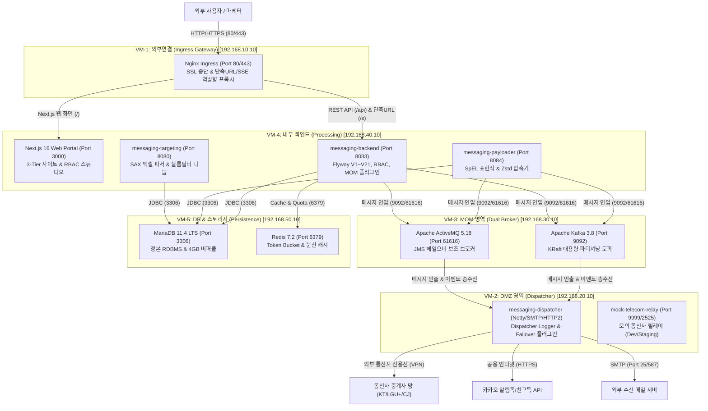

# 🚢 엔터프라이즈 멀티채널 메시징 플랫폼 — 5대 VM 분리 Podman 배포 가이드

본 가이드는 프로덕션 및 온프레미스 망분리 보안 규정에 맞추어 **5대 독립 가상머신(VM)** 환경에 컨테이너를 배치하고 Podman(`podman-compose` 또는 `podman play kube`)으로 배포하는 통합 인프라 가이드입니다.

---

## 🏛️ 1. 5대 VM 영역 분리 아키텍처 및 네트워크 토폴로지



---

## 🔒 2. VM별 보안 격리 및 방화벽(Firewall) 정책

| VM 명칭 | 권장 사양 | 배치 컨테이너 | 인바운드 허용 포트 | 아웃바운드 허용 목적지 | 보안 원칙 |
| :--- | :---: | :--- | :--- | :--- | :--- |
| **VM-1: 외부연결** | 2 Core, 4GB | `nginx-ingress` | `80/tcp`, `443/tcp` (공용) | VM-4 (`3000`, `8083`) | 외부 공용 접점, SSL 종단, WAF 적용 |
| **VM-2: DMZ 영역** | 4 Core, 8GB | `messaging-dispatcher`<br/>`mock-telecom-relay` | `8081/tcp` (모니터링) | 통신사 VPN 망, 카카오(443), 외부 SMTP(25/587), VM-3 (`9092`, `61616`) | **DB 직접 접근 원천 차단** (DB 계정 없음) |
| **VM-3: MOM 영역** | 4 Core, 8GB | `kafka-broker`<br/>`activemq-broker` | `9092/tcp`, `61616/tcp`, `8161/tcp` | VM-2, VM-4 내부망 응답 | 내부 백본 통신망, 외부 인터넷 직접 접근 차단 |
| **VM-4: 내부 백엔드** | 8 Core, 16GB | `messaging-backend`<br/>`messaging-frontend`<br/>`messaging-payloader`<br/>`messaging-targeting` | `3000/tcp`, `8083/tcp`, `8084/tcp`, `8080/tcp` (VM-1에서만 접근) | VM-3 (`9092`, `61616`), VM-5 (`3306`, `6379`) | 최고 수준 애플리케이션 격리, 단일 DB 접근 권한 |
| **VM-5: DB & 캐시** | 8 Core, 16GB | `mariadb-server`<br/>`redis-server` | `3306/tcp`, `6379/tcp` (**VM-4에서만 허용**) | 내부 패키지 업데이트 전용 | **최고 보안 영역**, DMZ/외부망과 완전 차단 |

---

## 🚀 3. VM별 Podman 배포 가이드

### 1) 사전 준비 (공통)
각 VM에 Podman 및 Podman Compose를 설치합니다:
```bash
# RHEL / Rocky Linux / AlmaLinux 9
sudo dnf install -y podman podman-docker podman-compose

# Ubuntu 22.04 / 24.04 LTS
sudo apt-get update && sudo apt-get install -y podman podman-compose
```

---

### 2) [Step 1] VM-5 데이터베이스 배포 (가장 먼저 실행)
```bash
# VM-5 (192.168.50.10) 접속
cd deploy/podman/vm5-database

# 컨테이너 실행
podman-compose up -d

# 헬스체크 확인
podman ps
podman exec -it db-mariadb mariadb-admin ping -u root -pmariadb_root_pass
```

---

### 3) [Step 2] VM-3 MOM 브로커 배포
```bash
# VM-3 (192.168.30.10) 접속
cd deploy/podman/vm3-mom

# 컨테이너 실행
podman-compose up -d

# 브로커 상태 확인
podman ps
# Kafka 토픽 테스트
podman exec -it mom-kafka /opt/kafka/bin/kafka-topics.sh --bootstrap-server localhost:9092 --list
```

---

### 4) [Step 3] VM-4 내부 백엔드 & 파이프라인 배포
```bash
# VM-4 (192.168.40.10) 접속
cd deploy/podman/vm4-backend

# 컨테이너 실행 (Spring Boot 구동 시 Flyway V1~V21 자동 실행)
podman-compose up -d

# 백엔드 기동 로그 확인
podman logs -f portal-backend
```

---

### 5) [Step 4] VM-2 DMZ Dispatcher 발송 엔진 배포
```bash
# VM-2 (192.168.20.10) 접속
cd deploy/podman/vm2-dmz

# 컨테이너 실행
podman-compose up -d

# 디스패처 기동 및 MOM 연결 확인
podman logs -f messaging-dispatcher
```

---

### 6) [Step 5] VM-1 외부 Ingress Gateway 배포 (최종 인입 활성화)
```bash
# VM-1 (192.168.10.10) 접속
cd deploy/podman/vm1-external

# Nginx 구동
podman-compose up -d

# 외부 접속 테스트
curl http://localhost/health
```

---

## 🛠️ 4. 장애 복구 및 일괄 제어 명령

```bash
# 특정 VM 컨테이너 재시작
podman-compose restart

# 로그 실시간 모니터링
podman-compose logs -f --tail=100

# 컨테이너 안전 중지
podman-compose down

# 볼륨 데이터 유지하면서 재배포
podman-compose pull && podman-compose up -d
```
